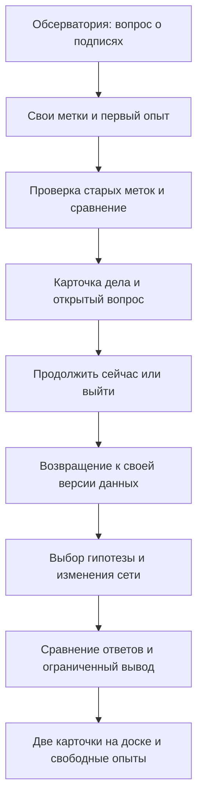
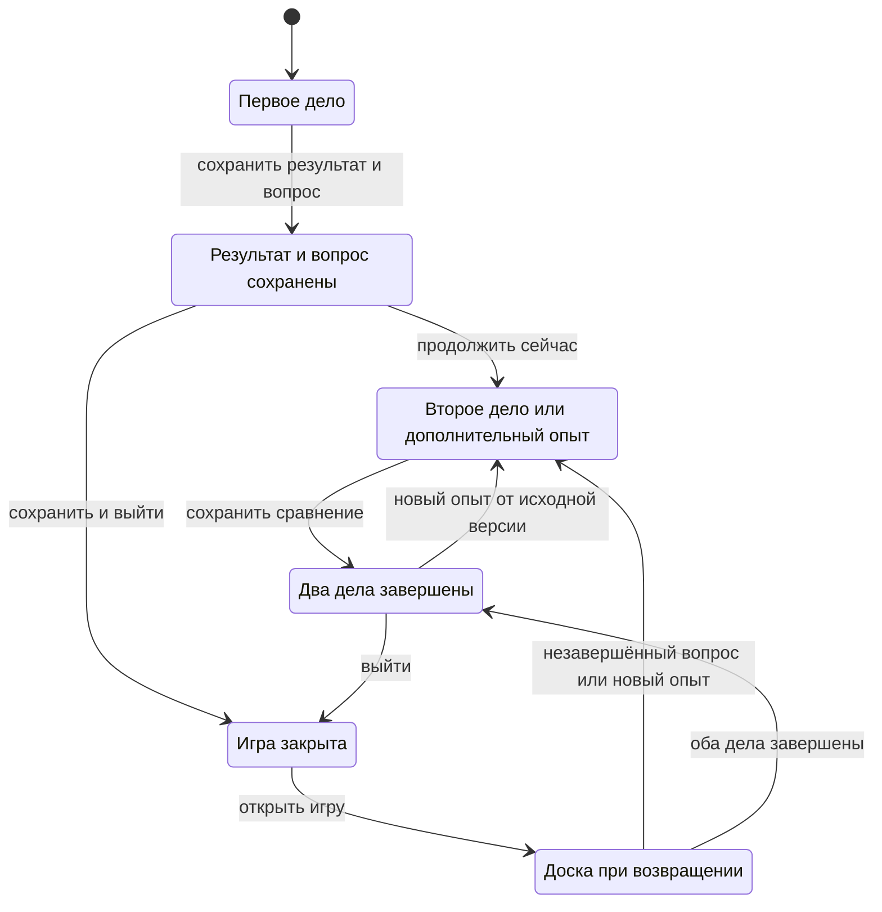

# Два исследования: чужие подписи и вторая проверка

**Статус: предложение от 18 октября 2026.** Цель владельца — самостоятельная игра, в которую хочется возвращаться. Этот документ развивает [обзор направления](product-review.html). Публикация разрешена; реализация новых механик этим документом не утверждается. Аудитория около 12 лет и настольный браузер остаются рабочими предположениями.

Предлагаем начало кампании из двух исследований по 10–15 минут каждое. Это ориентир для проектирования и последующей проверки, а не измеренное время. Игрок приносит из первого дела собственную версию данных и конкретный открытый вопрос. Во втором он выбирает проверку этого вопроса и сохраняет сравнение. Обсерватория хранит эту работу между запусками.

[Первое дело](#case-1) · [Второе дело](#case-2) · [Возвращение](#return) · [Научная опора](#science) · [Проверка идеи](#validation)

## Предложение в одном взгляде

| | Дело 1. «Чужие подписи» | Дело 2. «Тот же снимок, другой опыт» |
|---|---|---|
| Вопрос | Можно ли доверять меткам, на которых училась сеть? | Что изменится, если изменить устройство сети, сохранив данные? |
| Решение игрока | Какой снимок и какую метку проверить; что изменить или оставить | Какую гипотезу проверить и какое одно изменение сети сделать |
| Наблюдение | Ответы до и после проверки меток на тех же снимках | Ответы двух сетей на одном сохранённом наборе |
| Результат в комнате | Карточка опыта, версия меток, выбранный открытый вопрос | Пара сравнимых опытов и вывод с границей применимости |
| Причина продолжить | «Этот ответ всё ещё требует объяснения. Я хочу проверить свою версию» | «Теперь я могу выбрать другой опыт и сравнить его со своей работой» |

**Проверенная связка для авторского примера:** исправление трёх старых меток меняет результат одной CNN с 1/3 на 2/3. Ответ для NGC 3982 остаётся ошибочным. Добавление второй свёртки на тех же данных сохраняет эти три ответа. Числа взяты из действующих таблиц; игрок не обязан попасть в этот вариант. Его метки сохраняются, а реплики и выводы зависят от фактического результата.

## Что меняется относительно нынешней игры

В [согласованном маршруте 9 октября](../design-2026-10-09/night-of-discoveries.md) уже есть разметка, исправление старых меток, опыт с двумя свёртками, самостоятельное изменение сети и финал. Делить этот урок пополам недостаточно: игрок может воспринять продолжение как оставшуюся домашнюю работу.

Предлагаем четыре изменения: выбор исследуемого противоречия, короткий план **до** запуска опыта, сохранение доказательства и вопроса, использование этой записи в следующей смене. У каждого дела есть собственный законченный результат. Получить лучший счёт для завершения не требуется.

Первый законченный фрагмент переиспользует комнату, Нику, карту, снимки, рабочий стол CNN и рассчитанные результаты. Основные новые части — доска двух дел, запись опыта, переход между делами и сохранение между запусками. Новые научные наборы, экономика оборудования, аккаунты и многопользовательская игра находятся за пределами предложения.

В записи различаются вычисленное наблюдение и объяснение игрока. Если выбранная фраза противоречит показанным ответам, Ника предлагает сопоставить один объект или выбрать «Пока не уверен». Личная гипотеза сохраняется как гипотеза; игра не подтверждает её автоматически. Неуверенность позволяет закончить дело с открытым вопросом.

## Дело 1. «Чужие подписи» {#case-1}

### Завязка и обещание игроку

Ника готовит небольшой атлас галактик. Подписи пришли из нескольких учебных подборок; часть старых меток требует проверки. Игрок должен выяснить, что изменится в работе модели после собственной проверки данных.

Пример вступительной реплики: «Снимки выглядят по-разному. Но подпись могла ошибиться ещё до того, как её увидела сеть. Поможешь проверить, чему мы её учим?» Преднамеренные ошибки относятся к учебной подборке авторов игры. Это не утверждение об ошибках NASA или ESA.

### Сценарий

| Этап | Что делает игрок | Что отвечает игра |
|---|---|---|
| 1. Найти материал | В первый раз собирает существующие четыре снимка: M85, IC 5332, NGC 5023, NGC 3318. Выбирает порядок. | Снимки появляются на столе; повторно посещать карту ради уже найденных объектов не нужно. |
| 2. Назвать видимые признаки | Проходит один пример с Никой, затем ставит четыре собственные метки. Подсказка и увеличение доступны отдельно. | Метка игрока, справочная метка и будущий ответ сети показаны как разные сведения. |
| 3. Получить противоречие | Открывает первую проверку и выбирает снимок, чей ответ хочет разобрать. | Сначала видны три пары «снимок — ответ», затем общий счёт. Ника реагирует на реальные ответы, включая 3/3. |
| 4. Выбрать проверку данных | Может сначала пересмотреть свою метку или открыть старую подборку. В старой подборке сам выбирает порядок трёх снимков; метку можно изменить либо подтвердить. | Рядом остаётся список изменений. Ника спрашивает о признаке на изображении, не выдаёт обязательную комбинацию меток. Гипотезу об устройстве сети можно записать для второго дела. |
| 5. Сравнить | При той же архитектуре запускает опыт с текущими метками. Отмечает изменившийся ответ или «ответы не изменились». | Сравнение фиксирует обе версии данных и те же три проверочных объекта. При нескольких изменённых метках вывод относится ко всему изменённому набору. |
| 6. Оставить результат | Собирает короткую запись: «проверял → изменил/подтвердил → увидел → хочу проверить дальше». | На доске появляется карточка с выбранным снимком, результатом и вопросом. Доступны продолжение и сохранение с выходом. |

У игрока есть две содержательные альтернативы внутри проверки: исследовать собственные новые метки или старые, а затем изменить подозрительную подпись или сохранить её с объяснением. Другая архитектура пока обозначена как следующий исследовательский вопрос; интерфейс не изображает её доступным действием, если она ещё не открыта.

### Допустимые исходы

| Наблюдение | Поддерживаемый вывод и реакция Ники |
|---|---|
| Правильных ответов стало больше | «При этих изменённых метках и этой сети ответы стали ближе к справочным». Ника предлагает выбрать оставшийся вопрос. Причина всех ошибок ещё не установлена. |
| Ответы прежние | «В этом сравнении изменение данных не изменило выбранные классы». Ника помогает различить отсутствие эффекта и отсутствие изменения самих меток. |
| Счёт тот же, отдельные ответы другие | Сравниваются карточки объектов. Одинаковое число правильных ответов не заменяет сравнение самих ответов. |
| Результат ухудшился | Ника сохраняет обе версии: «Этот вариант тоже дал нам сведения. Что именно поменялось?» Можно вернуться к прежней версии или завершить с открытым вопросом. |
| Игрок подтвердил все метки и ничего не изменил | Запись честно говорит: «Метки просмотрены; влияние изменения данных ещё не проверяли». Дело можно отложить или закрыть с этим ограничением. Повтор того же запуска не изображается новым доказательством. |
| Получено 3/3 | Зацепка: «На этих трёх всё совпало. Сохранятся ли ответы при другом устройстве сети?» Игра не создаёт искусственную ошибку. |

**Граница завершения:** первая проверка сохранена, три старых снимка просмотрены, игрок указал наблюдение и следующий вопрос. При изменении меток нужно показать пару результатов; без изменения сохраняется явный статус «влияние не проверено». Ника может помочь выбрать формулировку. Обязательного сочинения и порога счёта нет.

### Что переносится во второе дело

Переносятся все семь выбранных меток, исходный и последний проверенный опыт, выбранный объект и вопрос. Пример записи при эталонных метках: «Проверил старые подписи. Ответ NGC 4762 изменился; NGC 3982 всё ещё назван гладким. Хочу проверить другую сеть». Если ошибки уже нет, переносится вопрос об устойчивости ответов. Сохранённая работа игрока не заменяется авторским примером ради красивого сюжета.

## Дело 2. «Тот же снимок, другой опыт» {#case-2}

### Вход через собственную работу

При возвращении камера показывает доску. На ней — снимок, выбранный в первом деле, и две короткие строки: «Что мы уже проверили» и «Что осталось узнать». Основное действие: **«Продолжить этот вопрос»**. Рядом доступны журнал и свободная карта. Повторного поиска четырёх галактик, разметки и вводного урока нет.

Пример реплики для сохранившейся ошибки: «Мы проверили подписи, а этот ответ всё ещё расходится со справочным. Ты хотел проверить устройство сети. Что изменим?» Для 3/3 реплика спрашивает об устойчивости совпавших ответов. Для неподтверждённого опыта Ника напоминает, что влияние меток пока не проверено; игрок может вернуться к нему либо исследовать архитектуру с этим ограничением.

### Новый выбор

Перед запуском игрок выбирает, что его интересует: ответ конкретного объекта или изменения во всей проверочной тройке. Затем выбирает **одну** операцию:

| Операция | Проверяемое предположение | Что сохраняется |
|---|---|---|
| Добавить вторую свёртку: `d1-r → d2-r` | «Ещё один свёрточный слой изменит этот ответ» | Метки, снимки, подготовка входа и протокол опыта |
| Добавить BatchNorm после ReLU: `d1-r → d1-r-bn` | «Нормирование промежуточных признаков изменит этот ответ» | Те же данные и одна свёртка; справка объясняет нормирование и обучаемые параметры |

Ника сначала объясняет действие коротко, рядом со схемой. Подробности открываются по запросу. Пользователь может выбрать «Пока не знаю, просто проверю» вместо предсказания результата. Это обозначает исследовательский опыт, а не заранее подтверждённую гипотезу.

**Предлагаемое изменение учебного контракта:** вместо обязательного прохода «показать вторую свёртку, затем выполнить ещё один опыт» основным становится одно выбранное игроком сравнение. Показ Ники доступен как помощь. Совместный опыт явно отмечается в журнале; его не считают самостоятельным решением при оценке плейтеста. Полный набор из 22 архитектур остаётся пространством дополнительных опытов после завершения дела.

### Сценарий сравнения

1. Игрок открывает сохранённую версию данных; схема `d1-r` и её проверенный результат служат общей точкой сравнения.
2. Выбирает вопрос, операцию и ожидаемое наблюдение. Кнопка запуска описывает действие: «Сравнить эти две сети».
3. Игра показывает ответы до/после для каждого из трёх объектов. Счёт вторичен. Выбранный игроком объект выделен, остальные доступны рядом.
4. Игрок отмечает, что изменилось, и выбирает ограниченный вывод. Если он говорит «сети одинаковы», Ника предлагает уточнение: «Одинаковы все сети или эти три ответа в нашем опыте?» Нет наказания и сброса прогресса.
5. На доске сохраняется пара опытов. Можно закончить дело, проверить другую операцию от той же исходной схемы или открыть известный авторам итоговый набор.

Изменение меток во время сравнения создаёт новую ветку данных и требует новой исходной проверки. Интерфейс не приписывает различие одной архитектуре, если одновременно изменились данные. Старое дело остаётся неизменяемой записью; новые опыты не переписывают прошлый вывод.

### Исходы и завершение

Если классы совпали, вывод звучит так: «На этих трёх снимках выбранное изменение сети не изменило ответы». Значения softmax могут различаться; по желанию можно открыть их как выходные числа модели, с пояснением, что это не надёжность ответа.

Если классы различаются, игрок показывает конкретный изменившийся ответ. Улучшение, ухудшение и смешанный результат допустимы. При одинаковом счёте сравнение не пропускается: ошибки могли переместиться между снимками. Утверждать, что одна архитектура лучше вообще, по этому опыту нельзя.

**Граница завершения:** выбран вопрос и изменение, выполнен один сравнимый опыт, отмечено фактическое наблюдение и сохранён вывод с ограничением «на этих снимках, с этими метками». При помощи Ники статус остаётся «сделали вместе». Высокий счёт и правильное предсказание результата не требуются.

### Необязательный эпилог: граница вывода

После сохранения вывода можно открыть итоговую тройку, уже известную авторам игры. Это подготовленная иллюстрация на других объектах. Для пары `d1-r/d2-r` с эталонными метками одинаковые ответы проверочной тройки сменяются разными ответами на NGC 2768. Ника предлагает дополнить запись: «Совпадение на трёх примерах не означает одинаковые ответы на всех снимках».

Эпилог показывает зафиксированную пару, не предлагает выбирать победителя и перебирать сети по итоговому счёту. Это не новая независимая оценка модели. Для иных меток вывод строится по реальным ответам: различие на NGC 2768 не обещается. Если ответы снова совпали, граница вывода остаётся прежней, но прямого контрпримера в этом опыте нет.

## Зачем возвращаться в обсерваторию {#return}

| Причина | Как она становится видимой | Чем проверять гипотезу |
|---|---|---|
| Остался собственный вопрос | В конце первого дела игрок выбирает объект и следующий опыт; именно они встречают его при возвращении | Может ли он своими словами назвать, что собирался узнать |
| Прошлая работа понадобится | Второе дело открывается с его метками и сравнением; не нужно повторять сбор | Узнаёт ли игрок свою работу и использует ли её для решения |
| Появился новый способ действия | Первое дело открывает сравнение архитектур; второе — сохранённые пары и дополнительные опыты | Выбирает ли игрок эксперимент по своему вопросу, а не по самой заметной кнопке |
| Есть чувство своего места | На доске остаются снимки, версии данных и короткие выводы; Ника ссылается на конкретную запись | Замечает ли игрок изменение комнаты и понимает ли его смысл |
| Можно спокойно уйти | Есть «Сохранить и выйти», а следующее дело доступно сразу и после возвращения | Восстанавливается ли смысл работы после закрытия браузера |

Доска хранит максимум две главные карточки в первом фрагменте. Компьютер открывает активный опыт, карта — исследуемый объект или свободный архив, Ника — разговор о текущем вопросе. Эти действия остаются частью существующей комнаты. Новые панели не должны перекрывать обсерваторию или превращать её в обязательное меню перед каждым действием.

После первого дела доступны **«Продолжить исследование»** и **«Сохранить и выйти»**. Календарной блокировки нет. Перерыв не меняет данные, награды или отношение Ники. Не нужны ежедневные серии посещений, исчезающие задания и напоминания о долге. «Следующая смена» обозначает новую часть исследования; снимки остаются архивными, и игра не изображает получение свежих наблюдений за время отсутствия.

После второго дела завершённая история остаётся завершённой. Доступны другие сравнения и научные карточки свободной карты, но они не выдаются за готовое третье дело. Два исследования проверяют один цикл добровольного возвращения. Для продолжительной кампании потребуется новый исследовательский вопрос и подходящие данные; одно расширение списка архитектур этого не обеспечивает.

## Что именно сохраняется между запусками

Сейчас [lesson-storage.js](../../designlab/galaxy-shift/lesson-storage.js) использует `sessionStorage`; это не контракт длительного хранения между закрытиями браузера. Для предложения требуется отдельная сохранённая кампания без обязательной учётной записи.

| Запись | Состав и поведение |
|---|---|
| Кампания | Версия схемы сохранения, активное дело и шаг, найденные снимки, положение карты |
| Данные игрока | Семь меток с ID снимков, просмотренные старые снимки, версия набора и протокола |
| Опыт | ID архитектуры, ключ меток, версия/хэш таблицы, список проверочных объектов, ссылка на исходный опыт |
| Смысл работы | Выбранный вопрос и объект, ожидаемое наблюдение, отмеченный исход, вывод; свободный текст необязателен |
| Доска | Порядок двух карточек, статус «в работе / вывод сохранён / вопрос открыт», связь первого и второго дел |

Предлагаем хранить небольшой сериализованный профиль в `localStorage`, сохранять после смысловых действий и иметь экспорт/импорт JSON. Изображения и таблицы не копируются в профиль; научный результат восстанавливается из точного ключа совместимой таблицы. Индикатор «Сохранено на этом устройстве» появляется только после успешной записи.

При недоступном хранилище остаётся текущая работа и явное предложение скачать файл. Для ZIP через `file://` долговременное хранение проверяется отдельно в целевых браузерах; переносимый файл обязателен. Нельзя обещать продолжение на другом устройстве без импорта. При несовместимой версии сохраняются читаемая запись и исходный файл; игра объясняет, какой результат пока не может восстановить, и не подставляет похожий опыт.

Совместимый прогресс нынешнего урока предлагается переносить как «сохранённый учебный опыт». Если в нём не было гипотезы и вывода, эти сведения не выдумываются задним числом. Игроку предлагают продолжить с имеющимся опытом или отдельно начать два новых дела; старое сохранение не стирается без подтверждения.

## Научная опора и проверенные примеры {#science}

Проверено чтением текущей таблицы на исходниках `14ec367955e576149382ae104a0179ec5521bec7`; обучение заново не запускалось. [Компактная выписка результатов](evidence/linked-investigations-fixtures.json) содержит параметры, предсказания, хэши источников и дополнительные случаи для будущей проверки сценария.

Основной runtime уже использует CNN. Исторический классификатор ближайшего соседа и ранние CNN-таблицы с другим seed не используются в предложении. Набор — `2026-10-08-hubble-15-v4`, протокол — `2026-10-08-cnn-constructor-v1`, seed — `20261008`. Девять обучающих объектов, три проверочных и три итоговых; две метки фиксированы, семь редактируются. Центральные 75% снимка переводятся в серый вход 32×32; условия обучения закреплены в протоколе. Браузер показывает подготовленные расчёты.

| Пример | Условия | Проверенные ответы |
|---|---|---|
| Дело 1, исходный опыт | `d1-r`, ключ `0121100` | M49 — гладкая; NGC 3982 — гладкая; NGC 4762 — гладкая. 1/3 |
| Дело 1, после исправления старых меток | `d1-r`, ключ `0121021` | M49 — гладкая; NGC 3982 — гладкая; NGC 4762 — с ребра. 2/3 |
| Дело 2, другая глубина | Тот же `0121021`, `d1-r → d2-r` | Те же выбранные классы, 2/3 → 2/3; 55 → 203 обучаемых параметра |
| Дело 2, нормирование | Тот же `0121021`, `d1-r → d1-r-bn` | Те же выбранные классы, 2/3 → 2/3; 55 → 63 параметра |
| Эпилог для сравнения глубины | Тот же ключ, зафиксированная пара; известная авторам итоговая тройка | На NGC 2768 ответ меняется с «гладкая» на «с ребра»; справочная метка — «гладкая». |

В ключе меток цифры `0/1/2` означают `smooth/spiral/edge_on`. Порядок: `child_m85`, `child_ic5332`, `child_ngc5023`, `fixed_ngc3318`, `old_ngc3610`, `old_ngc7090`, `fixed_ngc691`. Исторический префикс `fixed_` у двух ID не отражает текущую редактируемость: ориентироваться следует на `editableIds`, `childIds` и `oldIds` протокола/runtime.

Связка 1/3 → 2/3 служит примером для авторов, не сценарием обязательной победы. При сохранении разных четырёх меток игрока и одной и той же коррекции старой тройки `100 → 021` среди 81 комбинации есть 51 улучшение счёта, 29 равных результатов и одно ухудшение. Это перебор конечной таблицы, не частоты поведения детей. В сравнении `d1-r/d2-r` для всех 2187 ключей также есть 394 случая одинакового счёта при разных ответах. Поэтому развилки нужны уже на имеющихся данных.

Ограничения вывода: три объекта не дают надёжной оценки обобщения; повторное использование проверочной тройки служит учебному исследованию; итоговый набор уже известен авторам; фиксированный seed не оценивает разброс результатов. Исправление нескольких меток не устанавливает вклад каждой из них. «Вид с ребра» — ракурс диска, а не отдельный физический тип. Softmax не является гарантией правильности. Реальные снимки и их атрибуция сохраняются; новый вывод игрока — личный учебный результат, не новое открытие астрономии.

## Порядок реализации после решения владельца

1. **Сохранённое доказательство.** Версии меток, пара опытов и короткий вывод; корректные ветки результата и восстановление после закрытия браузера. Это основа связи дел.
2. **Два завершённых дела.** Выбор проверки в первом, план опыта во втором, перенос своего вопроса, две карточки в комнате, понятное завершение без порога счёта.
3. **Проверка возвращения.** Техническое восстановление, затем качественный плейтест. По его результату уточнить первый экран возвращения, реплики и сложность выбора.
4. **Расширение.** Только после проверки этой связки решать, какое третье дело требует новых данных или нового инструмента. Дополнительные архитектуры сами по себе не заменяют новую задачу.

## Как проверить предложение {#validation}

### Техническая приёмка будущего игрового фрагмента

- Пройти оба дела с эталонными метками, с неизменным счётом и с ухудшением. Показать реальные результаты выписки; проверить, что ни один исход не блокирует завершение ради 3/3.
- Пройти вариант «все старые метки подтверждены»: не приписывать игроку проведённое вмешательство. Проверить одинаковый счёт с разными ответами и одинаковые классы с разными значениями softmax.
- Закрыть браузер после выбора вопроса, открыть его снова и продолжить с теми же метками, объектом, версиями и записью. Повторить на HTTPS и из ZIP; проверить экспорт/импорт и отказ хранилища без тихой потери.
- Изменить данные между опытами: игра требует сопоставимой исходной проверки и сохраняет предыдущую карточку. Повреждённый или несовместимый результат не заменяется близким.
- Основные действия и смысл сравнения доступны на существующих целевых экранах и при 150%; диаграммы, реплики и помощь доступны с клавиатуры. Видимый шаг не должен требовать незаметной прокрутки.

### Качественный плейтест

Предлагаемый первый набор — 5–8 участников целевого возраста. Сначала наблюдать первое дело, не объясняя за ребёнка причину каждого перехода. После него спросить открыто: «Что ты проверил? Что осталось узнать?» Записать, какую помощь оказала Ника или взрослый. Проверка интерфейса и понимания не подменяет интерес.

Затем оставить возможность по желанию продолжить сразу или вернуться к той же игре в ближайшие несколько дней. Не назначать вторую смену обязательным заданием и не отправлять напоминания в этом наблюдении. Разделять продолжение сразу, самостоятельный повторный визит, возвращение после приглашения взрослого и технические проверки. Малый набор и сам факт участия в исследовании не позволяют оценить рыночное удержание.

| Вопрос проверки | Что наблюдать | Какое решение это поддержит |
|---|---|---|
| Возник ли собственный вопрос? | Игрок называет объект/гипотезу и объясняет, зачем хочет продолжить | Оставить зацепку или переписать финал первого дела |
| Второе дело отличается от первого? | Выбирает изменение сети и объясняет, что оставляет прежним | Сохранить структуру выбора или упростить её |
| Комната хранит смысл? | После паузы узнаёт свою карточку и находит продолжение без повторного обучения | Доработать доску и краткое напоминание |
| Неизменный результат имеет ценность? | Может назвать наблюдение без требования «победить сеть» | Переписать реакции Ники и способ завершения |
| Есть добровольное возвращение? | Фактический повторный визит и названная игроком причина | Продолжать проверку кампании; без этого не объявлять удержание подтверждённым |

Для первого раунда предлагаем считать повторение одной и той же проблемы у двух участников поводом пересмотреть соответствующий шаг. Это рабочий критерий итерации, не статистический порог. Если возвращаются только по просьбе взрослого либо воспринимают второе дело как оставшуюся часть урока, сначала менять вопрос и последствия первого дела, затем проверять снова. Добавление следующих глав до этого остаётся рискованным расширением объёма.

## Источники и статус проверки документа

- [Обзор направления развития](product-review.html) — цель возвращения и исходная гипотеза двух дел.
- [Маршрут от 9 октября](../design-2026-10-09/night-of-discoveries.md), [учебная вычитка](../design-2026-10-09/learning-review.md) — действующие решения и границы прежних проверок.
- [README игры](../../designlab/galaxy-shift/README.md), [данные и метод](../../designlab/galaxy-shift/DATA-NOTES.md), [протокол CNN](../../designlab/galaxy-shift/experiments/cnn-label-correction/protocol.json), [таблица опытов](../../designlab/galaxy-shift/experiments/cnn-label-correction/cnn-experiments.json) — научная опора.
- [Состояние урока](../../designlab/galaxy-shift/cnn-session.js), [сохранение](../../designlab/galaxy-shift/lesson-storage.js) — текущие механизмы, которые потребуется расширить.

Проверены наличие исходных механизмов и числовые примеры в существующих таблицах. В этой работе создаётся и публикуется дизайн-документ; новые исследования, сохранение кампании и причины возвращения ещё не реализованы и не проверены с игроками.
