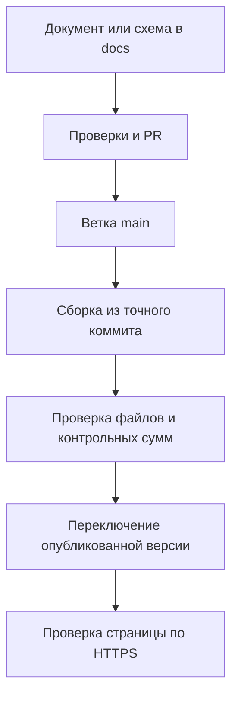

# Публикация дизайн-документов и схем

**Решение владельца от 18 октября 2026:** дизайн-документы и схемы проекта
публикуются на домене `sd2026.beetles.family`. Каталог расположен по адресу
[sd2026.beetles.family/design/](https://sd2026.beetles.family/design/).

В каталог входит [разбор направления развития игры](product-review.html).
Его предложения о связанных исследованиях не становятся принятыми решениями
из-за публикации. Текущий игровой маршрут продолжает задавать
[дизайн от 9 октября](../design-2026-10-09/night-of-discoveries.md).

## От исходника к публичной странице

Каталог автоматически обнаруживает новые материалы; ручное добавление
страницы в список не требуется. Исходники Markdown доступны для скачивания,
HTML и связанные изображения сохраняются, Mermaid отображается как схема.
Исторические материалы перечисляются отдельно от текущих по папкам редакций.

Сервер проверяет `main` примерно раз в две минуты. Сначала собирается новая
версия, затем проверяется целостность её файлов и переключается одна ссылка.
Если сборка или проверка не прошла, предыдущая публикация остаётся доступной.
Обновление документов не пересобирает игру и не меняет научные таблицы.

## Границы публикации

Публикуются зафиксированные в Git материалы проекта. Локальные временные
файлы, базы данных, личные заметки и секреты в публикацию не входят.
Научное происхождение изображений и статус утверждений сохраняются.

Игра остаётся по корневому адресу домена. Исторические ссылки `/docs/`,
старые привязки комментариев и их хранилище сохраняются. Новый каталог
использует `/design/` и не меняет текст старых обсуждений.

Команды сборки, приёмки, диагностики и отката находятся в
[инструкции публикации](../../tools/design-site/README.md).
